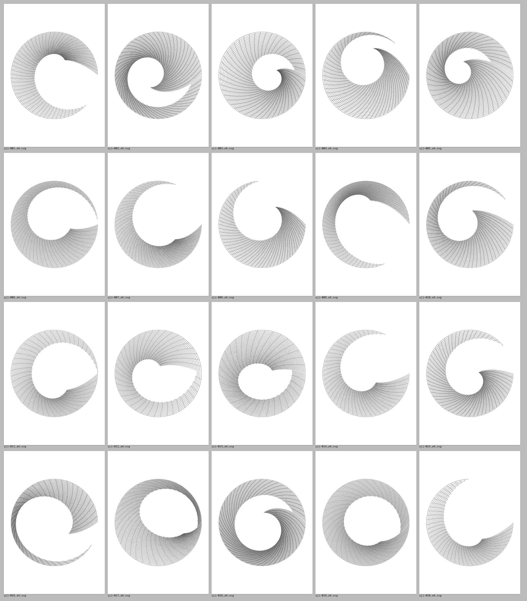

# wake-research

The research behind **[wake](https://github.com/preet-portfolio/wake)** ([live](https://wake-black.vercel.app) · [case study](https://wake-black.vercel.app/case.html)): how I took apart [uji](https://github.com/doersino/uji), a generative-art toy by Noah Doersing, measured it, extended it, and found out what survives a pen plotter.



## What's here

| Folder | What it is |
|---|---|
| [`uji/`](https://github.com/preet-portfolio/uji/tree/wake-series) | A fork of uji (submodule, `wake-series` branch) with two options added. **seed** makes every random draw reproducible, so a link redraws the same picture. **timeshear** gives each line segment its own clock. With both off, output is byte-identical to upstream. |
| `tools/` | Headless rendering with Playwright (`render.mjs`), parameter sweeps into contact sheets (`sweep.mjs`), the seeded plotter series (`series.mjs`), and `plotcheck.py`, a vpype-based plot-time and ink-density check for A4 with a 0.3 mm pen. |
| `out/contact-sheets/` | The sweeps, including the failed first timeshear (`01`–`03`) and the version that worked (`05`–`07`). |
| `out/svg/series/`, `out/plot-ready/` | The 20-seed plotter series and the plot-ready finals. |
| `docs/findings.md` | The working log: how uji draws, what seeding fixed, the 957-minute plot, the paper choosing circles, and the license reading. |
| `docs/statement.md` | The artist statement for the series. |
| `docs/wake-model.md`, `docs/mockups/` | The model and the interaction concepts that became wake. |
| `.claude/agents/` | The three small helper agents (on Claude Haiku) that mapped code, ran sweeps and ran plot checks. |

## Findings in one paragraph each

- **uji's share links weren't reproducible.** All randomness went through one unseeded `Math.random`, and jitter was on by default.
- **My first time shear did nothing.** Shifting the rotation's timing per point only slid points along the same circle; the contact sheets showed 100 identical circles. Giving each point its own clock (no drawing, no motion until its time) worked.
- **The screen look is unplottable.** A typical render needs about 957 minutes and 2.1 km of ink. Plottable pieces need about 60 well-spaced rings: 3–5 minutes, no over-inked cells.
- **The paper chose circles.** With seeds deciding the parameters and the plot check rejecting over-inking, squares and triangles always failed (corners fold lines onto each other). All 20 survivors are open circles.

## Run

```sh
npm install && npx playwright install chromium
python3.12 -m venv .venv && .venv/bin/pip install vpype     # vpype needs Python ≤ 3.12 here (Shapely)
node tools/render.mjs "seed=7,timeshear=60,expansionhori=0.99,expansionverti=0.99,jitter=0.3,iterations=80" out/svg/example --png
tools/plotcheck.sh out/svg/example.svg
```

Clone with `git clone --recurse-submodules` to get the uji fork.

## Credit

uji is by Noah Doersing (MIT, with a clause forbidding NFTs), and this work stays within it. Plotting statistics come from [vpype](https://github.com/abey79/vpype) by Antoine Beyeler. Made by Preet Panchal, with [Claude Code](https://claude.com/claude-code).
